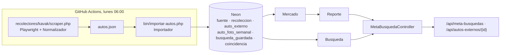
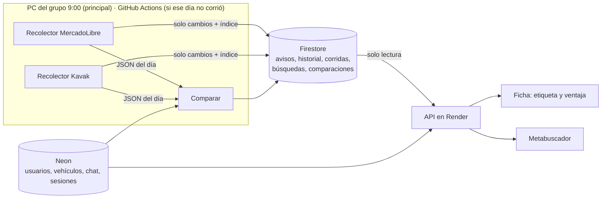

# Arquitectura del scraper, el comparador y el metabuscador

Estado al 07/11/2026. Lo que está acá está acordado, pero todavía no tiene código nuevo. La rama `feat/comparador` sale de la rama `scraper` de Taro (commit `068f2ba`), así que todo lo suyo está acá tal cual.

## 1. Para qué sirve cada cosa

Según el [modelo de negocio](https://github.com/Fedekasparian/AutoCar/tree/dev/modelo-de-negocio), el eje de AutoCar es **la publicación que se compara sola**: en cada publicación nuestra se muestra si el precio es bueno frente a autos iguales de otros sitios.

| | **Comparador** (el eje) | **Metabuscador** (plan comprador) |
|---|---|---|
| Arranca desde | Una publicación nuestra (tabla `vehiculo` de Neon) | Lo que busca el usuario (marca, modelo, año, precio) |
| Qué busca en los avisos scrapeados | Autos parecidos al nuestro, para sacar la mediana | Todos los autos que coinciden |
| Qué muestra | En la ficha: etiqueta, mediana y cuánto se ahorra | Lista de autos de todos los sitios, con link al aviso original. Los de AutoCar van primero y destacados |
| Cuándo funciona | Con 5 o más autos parecidos afuera | Con cualquier auto scrapeado |

Los dos leen **la misma colección de avisos**.

## 2. Lo que hizo Taro (rama `scraper`)

Es un **metabuscador con búsquedas guardadas y avisos**: el usuario guarda qué auto busca y AutoCar le avisa cuando aparece uno nuevo, baja de precio, se reserva o se retira. Hoy toma autos solo de Kavak y guarda todo en Neon.

Dentro del reporte etiqueta los autos de Kavak frente a otros autos de Kavak. Los autos de AutoCar aparecen sin etiqueta. **El comparador de nuestras publicaciones no está hecho**, pero las piezas para armarlo sí.

| Pieza | ¿Usa SQL? | Qué pasa con ella |
|---|---|---|
| `recolectores/kavak/scraper.php`, `Normalizador.php` | No | Se queda. Kavak ahora trae las tarjetas con precio en el HTML, así que podría pasar a curl sin Playwright |
| `Comparables.php`, `Estadistica.php` | No | Se queda. Es el corazón del comparador. Hay que sacar el filtro "misma plataforma" para comparar contra todas las fuentes |
| `Novedades.php` | No | Se queda. Sirve para escribir solo lo que cambió |
| `Reporte.php` | No | Se queda. Es la lógica del metabuscador |
| `Importador.php`, `Mercado.php` | Sí | Se reescribe el acceso a datos para Firestore. Las reglas (corrida incompleta si trae menos del 80 %, mínimo de comparables) se mantienen |
| `Busqueda.php`, `MetaBusquedaController.php` | Poco | Ajuste chico |
| Tests unitarios (16) | No | Se quedan |
| `.github/workflows/scraper.yml` | No | Se queda como respaldo. Cambia el paso de importar |

## 3. Arquitectura nueva

### Dónde se guarda

- **Neon** sigue con lo que ya tiene la app: usuarios, vehículos, chat y sesiones.
- **Todo lo del scraper, el comparador y el metabuscador va a Firestore** (NoSQL, plan gratis Spark).

Por qué NoSQL:
- Cada sitio trae campos distintos. Kavak tiene precio de contado y MercadoLibre no. Cada aviso guarda los suyos.
- Si mañana sumamos un atributo, los avisos nuevos lo traen y los viejos simplemente no lo tienen. No hay migración ni columnas en `null`.
- Son muchos datos (~92.000 autos) que cambian todos los días, se escriben una vez y se leen en lote.

| Antes en Neon (Taro) | Ahora en Firestore |
|---|---|
| `fuente` + `recoleccion` | `corridas/{fuente_fecha}`: fecha, si fue completa, cantidad de autos, dólar usado |
| `auto_externo` | `avisos/{fuente_id}`: cada aviso con los campos de su sitio |
| `auto_foto_semanal` | `avisos/{id}/precios/{fecha}`: solo cuando cambia el precio |
| `busqueda_guardada` | `busquedas/{id}`, con el id del usuario de Neon |
| `coincidencia` | `busquedas/{id}/avisos/{id}` |
| (no existía) | `comparaciones/{vehiculo_id}`: resultado del comparador para cada publicación nuestra |

### Límites del plan gratis y cómo no pasarse

| Límite | Riesgo | Cómo se evita |
|---|---|---|
| 20.000 escrituras por día | Reescribir los 92.000 avisos cada día | Se escriben **solo los cambios**: nuevos, cambios de precio y retirados. La carga inicial se reparte en varios días |
| 50.000 lecturas por día | Leer todo lo de ayer para saber qué cambió | Un **índice compacto de la corrida** (id + precio de todos los avisos) en 3 o 4 documentos. El comparador trabaja con el JSON del día, sin leer Firestore |
| 1 GiB | ~92.000 avisos de ~0,7 KB más el historial | Alcanza por meses |
| Lecturas del metabuscador | ~20 lecturas por página de resultados | Unas 2.000 búsquedas por día. Para el TP sobra |

Si se pasa un límite, Firestore deja de responder hasta el otro día y no cobra nada. Plan B: AWS DynamoDB (más escrituras gratis, pero pide tarjeta y firmar cada pedido) o volver a Neon como lo hizo Taro.

### Credenciales

- **Escritura** de Firestore: solo en la PC que corre el scraper y como secreto de GitHub Actions.
- **Solo lectura**: en Render, para el metabuscador y la ficha.
- Acceso por la API REST de Firestore con curl y `openssl` para firmar el token, sin librerías de terceros.
- El `.json` de la cuenta de servicio nunca se sube al repo.

### Moneda

- `vehiculo.precio` no tiene moneda: está en pesos.
- Se compara todo en pesos. Los avisos en dólares se pasan a pesos con el dólar del día, y se guarda qué cotización se usó.
- Al lado del precio se muestra el valor en dólares. Falta elegir qué dólar (propuesta: oficial venta).

### Fuentes

| Fuente | ¿La usamos? | Por qué |
|---|---|---|
| MercadoLibre | Sí | El más grande: 89.901 usados. Anda con curl |
| Kavak | Sí | Referencia de agencia: ~1.300 autos en 43 páginas |
| Autocosmos | Después | Anda con curl, se suma si sobra tiempo |
| DeMotores | No | Corta la conexión segura (error TLS 35) |
| Facebook Marketplace | No | Pide iniciar sesión y prohíbe scrapear |

## 4. Prueba de carga de MercadoLibre (07/11/2026)

Desde una PC con IP de casa: 200 páginas, una cada 3 segundos, recorriendo Volkswagen, Ford, Chevrolet, Toyota y Renault.

| Dato | Resultado |
|---|---|
| Bloqueos, captcha o páginas vacías | Ninguno |
| Autos distintos | 9.597 |
| Moneda | ~80 % pesos, ~20 % dólares |
| Tiempo por página | 1,3 s en promedio |
| Duración | 14 minutos |

- **Cada búsqueda llega como máximo a 42 páginas (~2.016 autos).** Para cubrir todo hay que buscar por modelo, y por año en los modelos grandes.
- Recorrer los ~90.000 autos son ~1.900 páginas: **unas 2 h 15 min por día** a este ritmo.

## 5. Pendiente

1. Medir cuántos autos cambian de un día para otro, para confirmar que alcanzan las 20.000 escrituras diarias.
2. Crear el proyecto de Firebase (Firestore en modo producción) y la clave de la cuenta de servicio.
3. Recolector de MercadoLibre por modelo, con el mismo formato común de Taro.
4. Capa de acceso a Firestore y migrar `Importador` y `Mercado`.
5. Comparador sobre nuestras publicaciones y su bloque en la ficha.
6. Metabuscador simple: resultados con link al aviso original.
