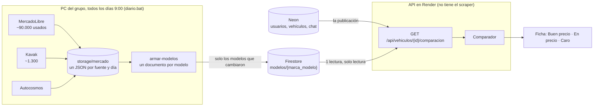
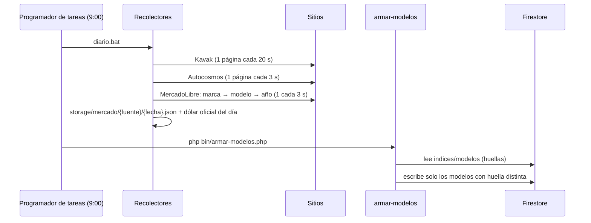
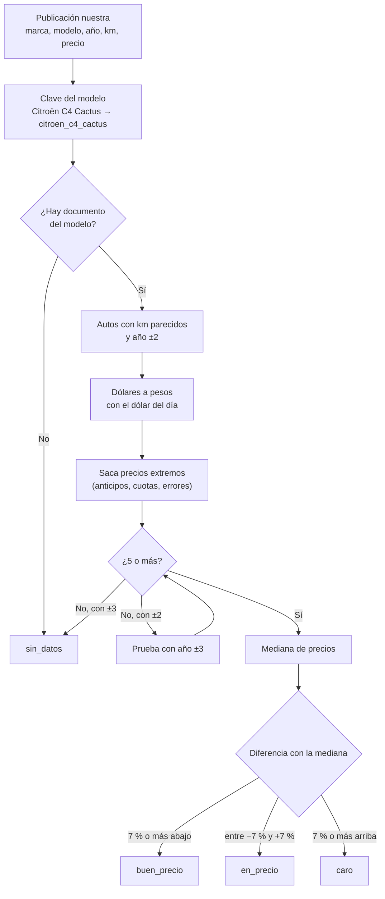
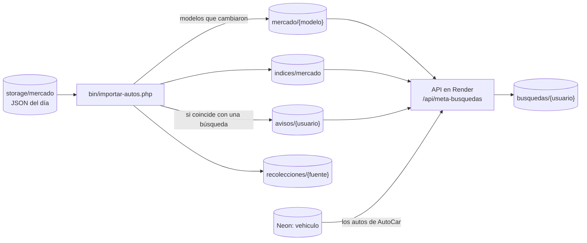

# Scraper y comparador de precios

Estado al 08/11/2026, en `dev` (vino de la rama `feat/comparador`). El recolector de cada sitio, el comparador y el endpoint de la ficha **ya están hechos y probados en local** con datos reales. Falta crear el proyecto de Firebase para que Render lea los datos (ver [Pendiente](#8-pendiente)).

## 1. La idea

Según el [modelo de negocio](https://github.com/Fedekasparian/AutoCar/tree/dev/modelo-de-negocio), el eje de AutoCar es **la publicación que se compara sola**: en cada publicación nuestra se muestra si el precio es bueno frente a autos iguales de otros sitios.

| | **Comparador** (el eje, hecho) | **Metabuscador** (plan comprador, después) |
|---|---|---|
| Arranca desde | Una publicación nuestra (tabla `vehiculo` de Neon) | Lo que busca el usuario (marca, modelo, año, precio) |
| Qué lee | El documento del modelo: todos los autos iguales de todos los sitios | El mismo documento del modelo |
| Qué muestra | En la ficha: etiqueta, mediana, cuánto se ahorra y los autos más parecidos con link | Lista de autos de todos los sitios, con los de AutoCar primero |
| Cuándo funciona | Con 5 o más autos parecidos afuera | Con cualquier auto scrapeado |

## 2. Arquitectura



**El scraper no se despliega.** Corre en la PC del grupo (IP de casa: MercadoLibre no bloqueó en 200 páginas seguidas). `recolectores/` y `storage/mercado/` están en `.dockerignore`, así que la imagen de Render no los tiene. Render solo lee Firestore con una credencial de solo lectura.

### Por qué un documento por modelo

En vez de guardar una comparación ya calculada por cada publicación, se guarda **un documento por modelo** (`volkswagen_gol_trend`) con todos los autos de ese modelo de todos los sitios, en forma compacta. La API compara en el momento.

- **1 lectura por ficha vista.** Con 50.000 lecturas gratis por día alcanza para 50.000 fichas.
- **Funciona para publicaciones nuevas** sin esperar a la corrida del día siguiente.
- **Pocas escrituras:** Firestore cuenta documentos, no autos, y cada documento es un modelo con todos sus autos. En el comparador solo se reescriben los modelos que cambiaron (huella); en el metabuscador se reescriben todos los que vinieron en la corrida, porque `ultima_vez` cambia cada día. Igual son ~2.000 a 4.000 escrituras por día y por proyecto, lejos de las 20.000 del plan gratis.
- **El metabuscador usa el mismo documento:** buscar "Gol Trend" es leer `volkswagen_gol_trend`.
- Si mañana se suma un sitio, solo se agrega su recolector: el documento suma autos con otra `fuente`.

## 3. Corrida diaria



- Si una fuente falla ese día, las otras siguen y `armar-modelos` usa la última corrida que haya de cada una.
- Una corrida cortada se guarda igual, marcada `"completo": false`.
- **MercadoLibre corta cada búsqueda en 42 páginas (~2.016 autos).** Por eso el recolector va por marca → modelo, y si un modelo tiene más, por año. La marca y el modelo salen del filtro de la búsqueda, no del título: son exactos.

## 4. Qué datos trae cada sitio

Lo que nos interesa para comparar es **marca, modelo, año, km y precio** (con su moneda). El resto se guarda si el sitio lo da.

| Campo | MercadoLibre | Kavak | Autocosmos | Lo usa el comparador |
|---|---|---|---|---|
| Marca y modelo | ✅ del filtro | ✅ | ✅ | Sí: tienen que ser iguales |
| Versión | ✅ del título | ✅ | ✅ | No (se muestra) |
| Año | ✅ | ✅ | ✅ | Sí: ±2 (±3 si faltan) |
| Km | ✅ | ✅ | ✅ | Sí: ±30 % (mínimo ±10.000) |
| Precio y moneda | ✅ ARS o USD (~20 % USD) | ✅ ARS | ✅ ARS o USD | Sí, en pesos |
| Precio de contado | — | A veces | — | Si está, se usa ese |
| Transmisión | — | ✅ | — | No (MercadoLibre no la da) |
| Combustible | — | — | — | No |
| Ubicación | ✅ | ✅ | ✅ | No (a futuro: por provincia) |
| Foto y link | ✅ | Link | ✅ | Se muestra en "autos parecidos" |

Sitios probados: **DeMotores** corta la conexión (error TLS), **Karvi** responde 403, **Facebook Marketplace** pide iniciar sesión, **OLX** ya no existe en Argentina. Quedan afuera.

## 5. Cómo decide el comparador



- La **mediana** y no el promedio: un auto mal cargado no la mueve.
- **Precios extremos:** se descartan los que quedan fuera de 1,5 veces el rango intercuartil (en MercadoLibre hay avisos con el anticipo como precio).
- **Regla de honestidad:** con menos de 5 autos parecidos no se muestra el dato, y si está caro, también se dice.
- Los valores (7 %, ±2 años, ±30 % km, mínimo 5) son constantes en `src/Comparador/Comparador.php` para ajustar con datos reales.

### Respuesta de `GET /api/vehiculos/{id}/comparacion`

Público, sin sesión. 404 si la publicación no existe o no es visible. 503 si Firestore no responde (la ficha sigue andando).

```json
{
  "vehiculo_id": 12,
  "comparacion": {
    "clave": "volkswagen_gol_trend",
    "fecha_datos": "2026-11-08",
    "precio": 15500000, "precio_usd": 9873, "dolar": 1570,
    "criterio": { "anios": 2, "km_pct": 30, "minimo": 5 },
    "etiqueta": "buen_precio",
    "texto": "9.2 % menos que el precio típico de 38 autos parecidos en otros sitios.",
    "diferencia_pct": -9.2, "ahorro": 1570000,
    "comparables": 38, "descartados": 2,
    "mercado": { "mediana": 17070000, "p25": 16000000, "p75": 18200000, "minimo": 14500000, "maximo": 21000000 },
    "km":   { "este": 98000, "mediana_mercado": 105000 },
    "anio": { "este": 2018, "mediana_mercado": 2018 },
    "por_fuente": [ { "fuente": "kavak", "cantidad": 3, "mediana": 18100000 }, { "fuente": "mercadolibre", "cantidad": 35, "mediana": 17000000 } ],
    "parecidos": [ { "fuente": "mercadolibre", "version": "1.6 Comfortline", "anio": 2018, "km": 99000, "precio": 16900000, "moneda": "ARS", "precio_ars": 16900000, "url": "https://auto.mercadolibre.com.ar/MLA-2268147919-_JM" } ]
  }
}
```

Con `"etiqueta": "sin_datos"` solo vienen `clave`, `fecha_datos`, `precio`, `precio_usd`, `dolar`, `criterio`, `texto` y `comparables`.

## 6. Metabuscador (NoSQL)

Desde el 08/11/2026 el metabuscador de Taro **ya no usa Neon**: todo lo que viene de otros sitios está en la base de documentos (Firestore en Render, archivos JSON en local). Las seis tablas que había (`fuente`, `recoleccion`, `auto_externo`, `auto_foto_semanal`, `busqueda_guardada`, `coincidencia`) y `migracion-meta-busqueda.sql` se borraron. La lógica de Taro (comparables, novedades, reporte, destacados, otros modelos) quedó igual: cambió solo dónde se guardan los datos.

| Colección | Qué guarda | Quién escribe |
|---|---|---|
| `mercado/{marca_modelo}` | Todos los autos del modelo, de todas las fuentes, con su historial (un renglón por cambio de precio, km o reserva), primera y última vez que se vio y estado (activo, reservado, retirado). Si no entra en 1 MiB se parte en `{clave}~1`, `{clave}~2`... | El importador (PC o Actions) |
| `indices/mercado` | Resumen de cada modelo: nombre, autos activos por fuente y rangos de precio, año y km. Con una lectura salen las marcas del formulario y los "otros modelos" | El importador |
| `recolecciones/{fuente}` | Las últimas 30 corridas: fecha, si fue completa y cuántos autos trajo | El importador |
| `busquedas/{usuario_id}` | Las búsquedas guardadas del usuario (hasta 20) y hasta cuándo vio los avisos de cada una | La API |
| `avisos/{usuario_id}` | Los últimos 300 avisos del usuario: nuevo, bajó, reservado, retirado | El importador |



**Por qué así.** Cada pantalla necesita pocos documentos enteros: un reporte lee el modelo buscado, el índice y las corridas; el detalle de un auto lee un solo documento (el id del auto ya dice de qué modelo es: `kavak~renault_sandero~562339`). No hace falta cruzar tablas. Las búsquedas y los avisos van en documentos distintos porque los escriben procesos distintos (la API y el importador) y así nunca se pisan.

**Marcas y modelos con un solo nombre.** No hay una tabla de equivalencias: el id de cada documento es la clave del modelo (`Clave::de`), que no cuenta mayúsculas, acentos ni signos ("Ds__3", "DS - 3" y "ds.3" → `ds_3`), saca la marca del modelo aunque venga pegada a un número ("DS3" → `ds_3`, "RAM1500" → `ram_1500`; "Rampage" no se toca) y resuelve apodos (`Clave::MARCAS`: "VW", "Mercedes", "D.S."). Lo que se muestra pasa por `Clave::nombreMarca` ("Ds", "KIA" → "DS", "Kia"), con los mismos nombres que la tabla `marca` de Neon. Lo que ninguna regla puede saber ("Clase C" = "C 200"?) quedaría para una lista hecha a mano.

**Marcas que no están en el catálogo.** El importador compara cada marca con el catálogo (`MARCAS_URL` = `GET /api/marcas-modelos` del back del mismo entorno). Si no está ("Peugot", una marca nueva), el auto no se carga, se avisa en la salida y no se da por retirado. `php bin/importar-autos.php --revisar-marcas archivo.json` lista solo esos autos con su link, sin importar nada: si es una marca real se agrega a `marca` con una migración (entran en la carga siguiente); si es un error del sitio, se suma como apodo.

**Escrituras.** El importador escribe los modelos que vinieron en la corrida (su `ultima_vez` cambia todos los días) y los que tenían autos de esa fuente, para retirar los ausentes. Con las corridas de prueba del 08/11 (6.081 autos) fueron 205 modelos; con las completas del 10/11 (Autocosmos: 4.750 autos, 441 modelos; MercadoLibre: ~80.000 autos, ~1.000 modelos) queda por debajo de las 20.000 escrituras diarias del plan gratis.

**Memoria.** La corrida completa de MercadoLibre arma un JSON de ~66 MB y llega a ~210 MB de memoria: con los 128 MB que PHP trae por defecto se moría al guardar. `diario.bat` corre MercadoLibre, `armar-modelos.php` e `importar-autos.php` con `php -d memory_limit=1G`. Una corrida que falla a mitad de camino se puede volver a importar: da el mismo resultado y los avisos no se repiten.

**Credencial.** Como la API escribe las búsquedas, la cuenta de servicio de Render tiene que ser de escritura (*Cloud Datastore User*), no de solo lectura.

**Lo que cambió para quien usa la API.** Los ids de los autos externos ahora son texto, y el detalle pasó de `GET /api/autos-externos/{id}` a `GET /api/autos-externos?id=...` (las rutas solo aceptan números). Marca y modelo se comparan por la clave del modelo ("VW Gol-Trend" = "Volkswagen Gol Trend"). El front todavía no consumía estos endpoints (es la tarea F7), así que no se rompió ninguna pantalla.

## 7. Archivos

| Archivo | Qué hace | ¿Va a Render? |
|---|---|---|
| `recolectores/mercadolibre/` | `Extractor.php` (lee la página, sin red) y `recolectar.php` | No |
| `recolectores/kavak/` | `ExtractorHtml.php` + `recolectar.php` (curl) y `Normalizador.php` (de Taro). El `scraper.php` con Playwright se borró el 11/11 | No |
| `recolectores/autocosmos/` | `Extractor.php` (microdatos schema.org) y `recolectar.php` | No |
| `recolectores/comun/` | `Http` (curl con pausa y reintentos), `JsonEmbebido`, `Salida` (JSON del día + dólar) | No |
| `recolectores/diario.bat` | La corrida diaria para el Programador de tareas de Windows | No |
| `bin/armar-modelos.php` | JSON del día → documentos por modelo → almacén | No se usa |
| `bin/comparar.php` | Prueba el comparador desde la consola | No se usa |
| `bin/medir-cambios.php` | Cuenta qué cambió entre dos corridas | No se usa |
| `src/Comparador/` | `Clave`, `Modelos`, `Comparador`, `Almacen` (+ archivos y Firestore), `Firestore` (REST con curl y openssl), `ComparadorController` | Sí |
| `src/MetaBusqueda/` | `Documentos` (+ archivos, memoria y Firestore), `Catalogo` (documento por modelo), `Indice`, `Importador`, `Busqueda`, `Avisos`, `Mercado`, `Reporte` | Sí |
| `bin/importar-autos.php` | JSON del día → `mercado/{modelo}`, índice, avisos | No se usa |
| `tests/Unit/ComparadorTest.php`, `RecolectoresTest.php` | 16 pruebas nuevas, sin red ni base | No |

Lo de Taro (`src/MetaBusqueda/`, rama `scraper`): el comparador usa su `Estadistica` y su `Normalizador` de Kavak, y su metabuscador pasó a la base de documentos (ver la sección 6).

### Probarlo en local

```
php recolectores/kavak/recolectar.php 3                    # 3 páginas (1 minuto)
php recolectores/autocosmos/recolectar.php 10              # 10 páginas
php recolectores/mercadolibre/recolectar.php --marcas=volkswagen --max-paginas=3
php bin/armar-modelos.php                                  # con COMPARADOR_ALMACEN=archivos (por defecto)
php bin/comparar.php Volkswagen "Gol Trend" 2018 110000 15500000
php bin/comparar.php --publicaciones                       # las publicaciones de Neon dev
```

Con la API local levantada, `GET http://localhost:8000/api/vehiculos/1/comparacion` lee los mismos archivos.

En Windows el PHP suele venir sin certificados para curl: `Http` usa solo los de Git for Windows, o los de la variable `CURL_CAINFO`.

### Prueba real (08/11/2026, PC del grupo)

MercadoLibre solo Volkswagen con tope de 3 páginas por búsqueda (140 pedidos, 4 minutos, sin bloqueos), Kavak 3 páginas y Autocosmos 10: **6.082 autos → 204 modelos**. El documento más grande pesa 201 KiB (Firestore admite 1.024).

| Auto de prueba | Resultado |
|---|---|
| Gol Trend 2018, 110.000 km, $ 15,5 M | `en_precio`: 2,5 % abajo de la mediana de 51 autos ($ 15,9 M) |
| Amarok 2015, 150.000 km, $ 30 M | `en_precio`: 4,7 % arriba de 430 autos |
| Polo 2020, 60.000 km, $ 28 M | `caro`: 15,1 % arriba de 21 autos |
| Fiat Cronos 2022, 60.000 km, $ 21 M | `buen_precio`: 8,7 % abajo de 5 autos (Autocosmos y Kavak) |

## 8. Pendiente (al 11/11)

1. ~~**Crear el proyecto de Firebase**~~: hecho el 10/11. Dos proyectos: `autocar-dev` (cargado con las corridas completas del 10/11: MercadoLibre 86.395 autos, Autocosmos 4.750, Kavak 1.330; comparador con 1.068 modelos) y `autocar-9897d` (prod, se carga en el pase `dev` → `main`). Render usa una cuenta de **escritura** (*Cloud Datastore User*), porque el metabuscador guarda las búsquedas.
2. **Programar la corrida diaria** en la PC: `schtasks /create /tn "AutoCar scraper" /sc daily /st 09:00 /tr "C:\...\Backend\recolectores\diario.bat"`. El `.env` de la PC necesita `MARCAS_URL` (sección 6).
3. ~~**Primera corrida completa de MercadoLibre**~~: hecha el 10/11 (~2 h 30 min, 86.427 autos). Falta la del día siguiente y `php bin/medir-cambios.php mercadolibre`, para tener el dato real de cuánto cambia por día.
4. ~~**Front:** el bloque de la ficha que consume `/api/vehiculos/{id}/comparacion`~~: hecho (front #50 y #52).
5. **GitHub Actions todos los días a las 06:00** (11/11): el workflow Scraper corre las tres fuentes y carga Firestore de **prod** (GitHub solo programa desde `main`; empieza a correr con el pase). Secretos por Environment (`prod` solo desde `main`, `dev` solo desde `dev`), cargados el 11/11. Detalle en `recolectores/README.md`.
6. ~~Pasar el metabuscador de Taro a NoSQL~~: hecho el 08/11 (sección 6). Queda unificar `modelos/{clave}` del comparador con `mercado/{clave}`, que hoy guardan casi los mismos autos dos veces.
7. **Modelos con distinto nombre dentro de una marca** ("4" y "DS4", "Clase C" y "C 200"): la clave no los puede igualar. Haría falta una lista de equivalencias hecha a mano.
