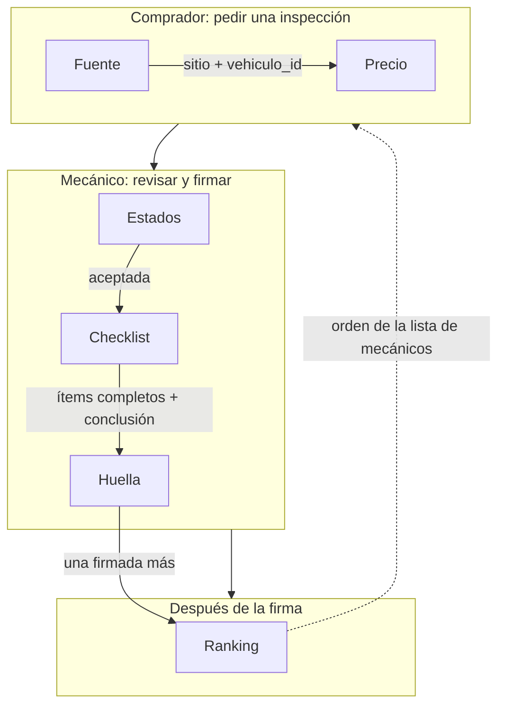
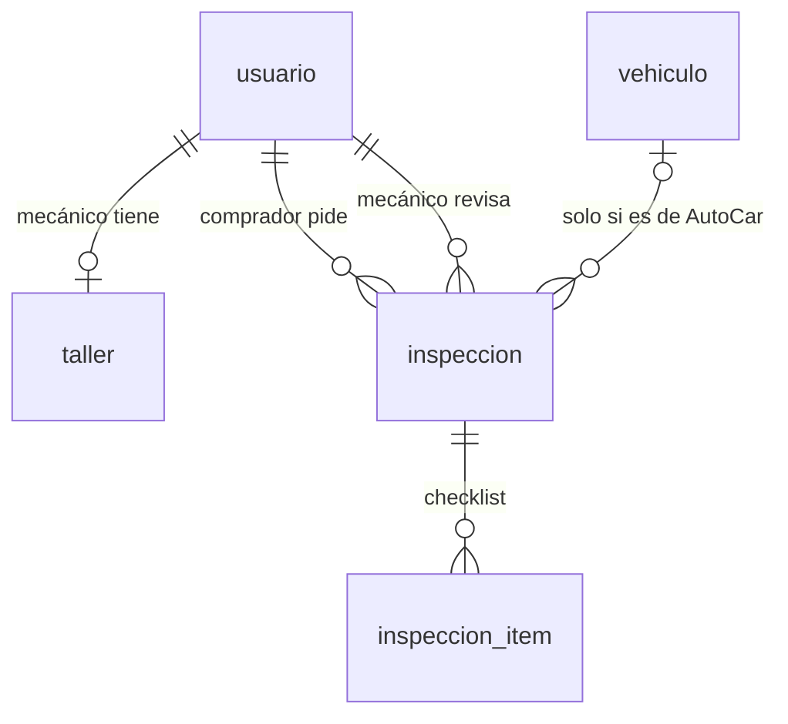
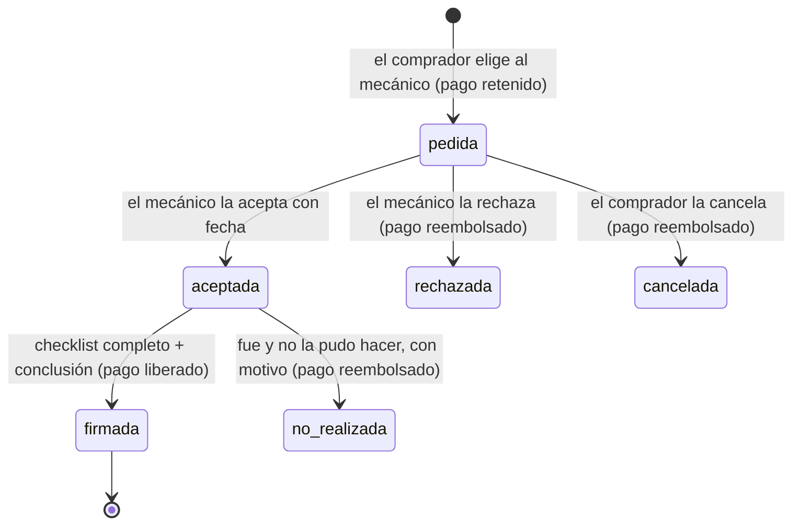

# Inspecciones: el mecánico que firma

Estado al 23/11/2026: la base, las reglas de negocio y todos los endpoints están hechos y con pruebas. **El 23/11 se sacaron los reclamos, el fondo de garantía y el historial por patente** (migraciones `034` y `035`, ver el § 1). Las reglas juntas están en el § 8. El porqué del modelo y el plan completo están en `modelo-de-negocio/README.md` y `PLAN.md` del repo del front.

## 1. La idea

El comprador encuentra un auto en cualquier sitio (MercadoLibre, Kavak, Autocosmos o AutoCar), pega el link y **elige** un mecánico de la red por su ranking. El vendedor no puede elegirlo. El mecánico revisa el auto con un checklist y **firma el informe con su nombre**, con fotos de lo que encontró y la patente con la foto de la chapa. Con eso el comprador decide **antes** de pagar el auto.

**El informe reduce el riesgo, no lo elimina.** Si al mecánico se le pasa algo, ese es el punto ciego del servicio, y es un riesgo que asume el comprador: no hay reclamo ni devolución después de la firma. Se sacaron el 23/11 (después de la devolución del profe) porque no se pueden verificar (nadie puede saber si la falla estaba el día de la inspección o apareció después) y porque llegan cuando el comprador ya compró, o sea cuando la decisión ya está tomada. Tampoco hay historial por patente: un auto puede dejar de estar publicado a las dos semanas y las inspecciones viejas quedan sin sentido.

AutoCar se queda una parte de cada inspección. Con el proveedor activo, el comprador paga en Checkout Pro y AutoCar consulta el resultado en la API de Orders. Con el proveedor desactivado, se usa el flujo simulado. [Ensayo de pago en desarrollo](demo-pago.md).

## 2. Los componentes

Las reglas son **funciones puras** en `src/Inspecciones/`: no tocan la base ni la red, así que se prueban solas (`tests/Unit/InspeccionesTest.php`). Los controladores validan el pedido con estas reglas y guardan el resultado.

| Componente | Qué resuelve | Lo usa |
|---|---|---|
| **`Fuente`** | De qué sitio es el link: `mercadolibre`, `kavak`, `autocosmos`, `autocar` u `otro`. Mira solo la URL, no entra a la página. Si es de AutoCar (`vehiculo.html?id=N` en un host de `FRONT_URL`), devuelve también el id del vehículo. El pedido rechaza los `otro` (422): el mecánico nunca abre un link de un sitio cualquiera | Pedir una inspección |
| **`Precio`** | El desglose: 23 % para AutoCar (redondeado a miles) y el resto para el mecánico. También el crédito si el auto se vendió | Pedir una inspección |
| **`Checklist`** | Los 10 ítems que se revisan y sus resultados (`ok`, `observado`, `falla`). Valida lo que manda el mecánico: a medias para guardar, completo para firmar. Si un ítem no está "ok", pide la nota | Guardar el informe, firmar |
| **`Huella`** | El SHA-256 del informe (ítems, conclusión, resumen, mecánico, taller y fecha) en un orden fijo. Prueba que el informe no cambió después de firmarlo. **No es una firma digital con validez legal** | Firmar, mostrar el informe |
| **`Estados`** | Qué cambios de estado se permiten y cómo queda el pago con cada uno | Aceptar, rechazar, cancelar, firmar |
| **`Ranking`** | El orden de la lista de mecánicos, por experiencia: cuántas inspecciones firmó cada uno (y de ese modelo o marca). Nadie paga para subir | Lista de mecánicos |

### Cómo se relacionan

El ranking cierra el círculo: cada informe firmado le suma experiencia al mecánico, y el que más autos de ese modelo revisó aparece primero.

## 3. Las tablas

Están en `database/schema.sql` (y en `database/006-inspecciones.sql` para la base de Neon que ya existe).

| Tabla | Qué guarda |
|---|---|
| `taller` | El perfil del mecánico: nombre, dirección, localidad, teléfono y precio de la inspección. La clave es el `usuario_id` del mecánico. `demo = true` en los talleres de ejemplo |
| `inspeccion` | El pedido entero: quién pide, a qué mecánico, el link y la fuente, los datos del auto, el estado, los montos que se fijaron al pedir, el estado interno del pago y, al firmar, la conclusión, el nombre del mecánico y del taller, la fecha y la huella |
| `inspeccion_item` | Un renglón por ítem del checklist: código, resultado y nota |

**La base también controla** lo más importante, por si un endpoint se equivoca: los montos del mecánico y de AutoCar suman el precio, nadie se inspecciona a sí mismo y una inspección firmada tiene que tener conclusión, firmante, fecha y huella.

Se copian datos a la inspección a propósito: el precio y los montos (el taller puede cambiar su precio después) y el nombre del mecánico y del taller al firmar (el informe tiene que seguir diciendo lo mismo aunque el mecánico cambie su nombre).

## 4. El ciclo de una inspección

- **La inspección es voluntaria para el vendedor.** Ninguna ley obliga a dejar revisar un usado. Si el vendedor no deja revisar el auto (o no está, o no es el auto del aviso), el mecánico la marca `no_realizada` con el motivo (`PATCH /api/mecanico/inspecciones/{id}` con `{"accion":"no_realizada","motivo":"..."}`, migración `018`): al comprador se le devuelve todo y ve el motivo en `motivo_rechazo`. Para el comprador, que el vendedor se niegue ya es información.

- Una inspección **firmada no cambia más**: cualquier intento tiene que dar 409.
- No hay reclamo después de la firma (§ 1).

## 5. El ranking

Por experiencia: primero los que tienen al menos `ranking_minimo_firmadas` inspecciones firmadas (de fábrica 3), de más a menos; después los "Nuevo en la red". Al pedir la inspección de un auto, primero van los que revisaron ese modelo, después los que revisaron esa marca y después el resto (cada grupo de más a menos revisados). Antes del 23/11 el puntaje salía de los reclamos que procedieron; sin reclamos, lo que se puede medir es la experiencia.

## 6. Datos de demo

`database/007-demo-inspecciones-solo-dev.sql`, **solo para la base de dev**: 5 mecánicos de Mercedes y Luján con su taller, marcados como demo. La contraseña de todos es `mecanico-demo`. Las inspecciones firmadas de ejemplo (para que el ranking tenga experiencia) se cargan con `php bin/demo-experiencia.php`, que firma con el mismo código que la API: así la huella de cada informe es la real.

## 7. Endpoints: hechos y pendientes

Los números son los del `PLAN.md`. Los controladores son `InspeccionController` (comprador y ranking público), y `MecanicoController`. El acceso a la base está en `Inspeccion` y `Taller`, y las reglas del pedido, también puras, en `Pedido`. Pruebas: `tests/Unit/Inspecciones*Test.php` y `tests/Integration/Inspecciones*Test.php`; `InspeccionesCompradorTest::testRecorridoDeLaDemo` recorre la demo del 30/11 entera por la API.

| Tarea | Endpoint | Componentes que usa | Estado |
|---|---|---|---|
| B2 | `GET/PUT /api/mecanico/perfil` | `Taller` | ✅ |
| B3 | `GET /api/mecanicos?localidad=&marca=&modelo=&orden=` | `Ranking` (`especialidad`, `porEspecialidad`), `Taller::red`, `Taller::revisados` | ✅ |
| B4 | `POST /api/inspecciones` | `Pedido`, `Fuente`, `Precio` | ✅ |
| B5 | `GET /api/mis-inspecciones`, `GET /api/inspecciones/{id}`, `POST .../cancelar` | `Estados` | ✅ |
| B6 | `GET/PATCH /api/mecanico/inspecciones...` | `Estados` (+ `validarTurno`, `validarMotivo`) | ✅ |
| B7 | `PUT .../informe`, `POST .../firma` | `Checklist`, `Huella`, `Estados` | ✅ |
| B8 | ~~Reclamos~~ | Se sacaron el 23/11 (migración `034`) | — |
| Adhesión | `POST /api/solicitudes-taller`, `GET/PATCH /api/admin/solicitudes-taller...` | `SolicitudTaller`, `Taller::validar` | ✅ |

**Quién no puede intervenir (409):** el mecánico no se pide una inspección a sí mismo (`mecanico_propio`), el vendedor no pide la de su propio auto de AutoCar (`vehiculo_propio`), no se elige al mecánico que publicó el auto (`mecanico_vendedor`)Tampoco se pide dos veces el mismo link mientras hay una en curso (`duplicada`).

**Solo se eligen mecánicos de la red:** taller **aprobado** y activo, cuenta activa y un rol con `verificaciones.realizar`.

**Cómo se suma un mecánico ("Adherí tu taller").** El taller manda sus datos sin estar logueado (`POST /api/solicitudes-taller`) y eso le crea una **cuenta aparte**, con un email que no tenga otra cuenta (un email es una sola cuenta, y el login es el mismo para todos: el panel depende del rol). La cuenta nace con rol `mecanico` y la solicitud queda `pendiente`: no aparece en el ranking y el login responde 403 `taller_pendiente`. Así la cuenta con la que alguien compra o vende queda separada de la del taller que firma. Un admin lo revisa en la cola (`GET /api/admin/solicitudes-taller`) y lo aprueba o lo rechaza con un motivo. Al aprobarlo, su taller entra al ranking y ya puede ingresar; si lo rechaza, al querer ingresar ve el motivo (403 `taller_rechazado`) y puede volver a mandarla corregida con el mismo email y contraseña. Lo aprueba un admin (permiso `usuarios.editar`, porque le cambia el rol) y no el propio mecánico porque el valor de AutoCar es que **el que firma es confiable**: si cualquiera se pudiera anotar solo, el ranking no valdría nada. La solicitud es la misma fila de `taller`, con `estado`, `cuit`, `horarios`, `motivo_rechazo` y quién la resolvió (`009-solicitud-taller.sql`). El ranking público no muestra el teléfono: el contacto pasa por AutoCar.

**Cómo se evitan los problemas de concurrencia.** Aceptar y rechazar hacen `UPDATE ... WHERE estado = 'pedida'`: si el comprador cancela al mismo tiempo, solo uno de los dos cambia la fila y el otro recibe 409. Guardar el informe y firmar bloquean la fila (`SELECT ... FOR UPDATE`) dentro de una transacción.

**La huella se puede volver a calcular.** El momento de la firma entra en la huella en UTC y al segundo (`Inspeccion::momentoHuella`), así da lo mismo con lo que se guardó que con lo que se lee de la base. La prueba de integración lo verifica.

Todavía no está decidido y no afecta a esta base:
- Qué datos del auto externo se completan solos con lo que juntó el scraper y cuáles carga el comprador.
- Los pagos al mecánico: se le paga lo suyo cuando firma (sin reclamos no hay por qué retenerlo).

## 8. Reglas de negocio (resumen)

Todas están en el back (el front repite algunas para avisar antes, pero la que vale es la del back). Los números (porcentajes, montos y días) están en la tabla `parametro` y los cambia el admin desde su panel (migración `021`).

**Cuenta del taller ("Adherí tu taller")**
- La cuenta del taller es **aparte** de la cuenta personal. Se crea con la solicitud, sin sesión (`POST /api/solicitudes-taller`).
- **Un email es una sola cuenta**: si el email ya tiene cuenta (aunque cambien mayúsculas), 422. El login es el mismo para todos; el panel depende del rol.
- Mientras la solicitud está **pendiente** o **rechazada**, la cuenta no puede ingresar (403 `taller_pendiente` / `taller_rechazado` con el motivo) y el taller no aparece en el ranking.
- La aprueba o rechaza **un admin** (`usuarios.editar`), nunca el propio taller. El rechazo lleva un motivo (5 a 300 caracteres).
- Rechazada, se vuelve a mandar con **el mismo email y la misma contraseña** (con otra, 422: así nadie pisa la solicitud de otro).
- En el front, el formulario se muestra solo **sin sesión**.

**Pedir una inspección**
- La pide y la paga **el comprador**. El vendedor no la elige ni la paga.
- Solo links de **MercadoLibre, Kavak, Autocosmos o AutoCar** (`Fuente`); otro sitio, 422. Se controla el dominio, **no** que el auto esté entre los que juntó el scraper.
- Si el comprador llega desde un aviso ("Mandale un mecánico" en el detalle del auto o en el metabuscador), el front deja el link **fijo**. Sin aviso, lo pega a mano (lo pidió el profe: un auto de cualquiera de esos sitios).
- Solo mecánicos **de la red**: taller aprobado y activo, cuenta activa y con `verificaciones.realizar`.
- 409 si hay interés propio: el mecánico no se pide una a sí mismo (`mecanico_propio`), el vendedor no la pide para su auto (`vehiculo_propio`), no se elige al mecánico que publicó el auto (`mecanico_vendedor`), y no se pide dos veces el mismo link mientras hay una en curso (`duplicada`).

**Plata (`Precio` y `Pagos/Cobros`)**
- Precio sugerido **$ 100.000**; cada taller pone el suyo entre **$ 70.000 y $ 150.000** (parámetros `precio_minimo`, `precio_sugerido` y `precio_maximo`). **77 %** para el mecánico y **23 %** para AutoCar (`comision_autocar`). Se redondea a $ 1.000. No hay fondo de garantía.
- Los montos se guardan al pedirla: si el taller cambia el precio después, no afecta a las pedidas.
- Pago: `retenido` al pedir → `liberado` al firmar, o `reembolsado` si el mecánico la rechaza, el comprador la cancela, no se hace o se cae.

**El informe**
- El mecánico acepta con un turno de **hasta 60 días** o rechaza con motivo.
- Checklist de **10 ítems** (`ok`, `observado` o `falla`); lo que no está `ok` exige nota. Conclusión: `recomendable`, `con_reparos` o `no_recomendable`.
- Cada ítem con `falla` necesita **una foto** de lo que vio el mecánico (en `observado` es opcional; migración `027`). Así una falla no es solo una palabra: el comprador la ve.
- Para firmar hacen falta los 10 ítems y la conclusión. La firma guarda el nombre del mecánico y del taller, el momento y la **huella SHA-256**. Firmada, **no cambia más** (409).

**Auto vendido (solo autos de AutoCar, `AutoVendido`; migración `024`)**
- El vendedor confirma el turno que dio el mecánico (`POST /api/inspecciones/{id}/confirmar-turno`). No sabe qué mecánico es.
- Si la publicación pasa a vendida, eliminada o rechazada **antes del turno**, la inspección queda `caida` y se le devuelve todo al comprador. Una edición (vuelve a `pendiente`) no la hace caer.
- Si el turno ya pasó (el mecánico fue), **se firma igual**. Si al firmar el auto ya está vendido, el comprador recibe un **crédito** del `credito_vendido` % del precio (30 %), no la devolución completa.
- **Cupón:** turno confirmado y auto vendido dentro de `horas_cupon` (48 h) después de la firma → el mismo crédito. Las dos condiciones se comprueban en la base.
- Un aviso de otro sitio que desaparece no siempre es un auto vendido: ahí no se hace nada solo.
- El crédito lo pone AutoCar de su parte, se descuenta solo en la próxima inspección del comprador y vuelve si esa se cae, se cancela o se rechaza.

**Idea A, costo total (`CostoTotal`, `Presupuestos`; migración `025`)**
- Al firmar, cada arreglo del informe (ítem observado o con falla; kilometraje e identificación no tienen arreglo) se le pide a `presupuestos_por_arreglo` (3) talleres de la red. **El taller que inspeccionó nunca recibe el pedido.** Primero los de su localidad, en el orden del ranking.
- Cada taller responde con un monto y un detalle (vale `dias_presupuesto`, 15 días) o rechaza; una sola vez.
- Costo total = precio del aviso + el presupuesto **vigente más barato** de cada arreglo. Si algún arreglo no tiene ninguno, se avisa que está incompleto.

**Idea B, fallas típicas por modelo (`FallaTipica`, `FallasTipicas`; migración `026`)**
- La inspección guarda marca y modelo del catálogo (la misma clave que el comparador). Obligatorios para firmar.
- Cada falla tiene su origen: **internet** (la carga el admin con la fuente) o **mecánicos** (la propone uno). El tercero, **medido**, sale de las inspecciones firmadas: qué % de los autos del modelo tuvo ese ítem observado o con falla.
- El voto de los mecánicos cambia el estado: con `fallas_votos_confirmar` (3) de un lado, y más que del otro, queda confirmada o descartada. Las descartadas no se le muestran al comprador.
- **No se muestra el porcentaje con menos de `fallas_minimo_inspecciones` (20)** inspecciones firmadas del modelo.

**Ranking**
- Por experiencia (§ 5): más inspecciones firmadas primero; con **menos de 3**, "Nuevo en la red". Nadie paga para subir.
- Sin reclamos ni fondo de garantía (§ 1): el informe reduce el riesgo, no lo elimina, y la decisión es del comprador.
