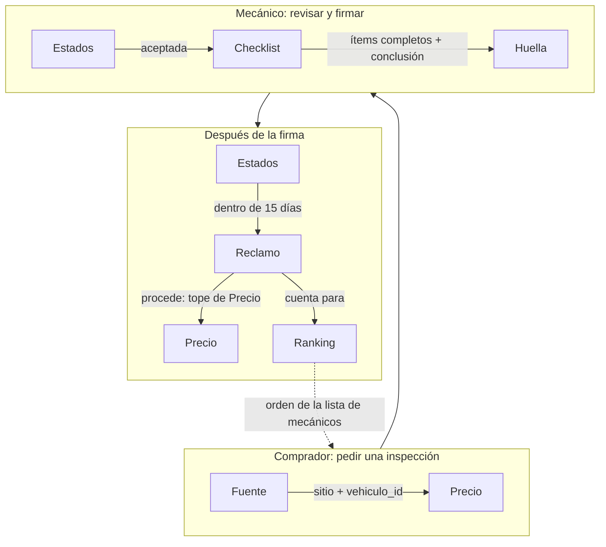
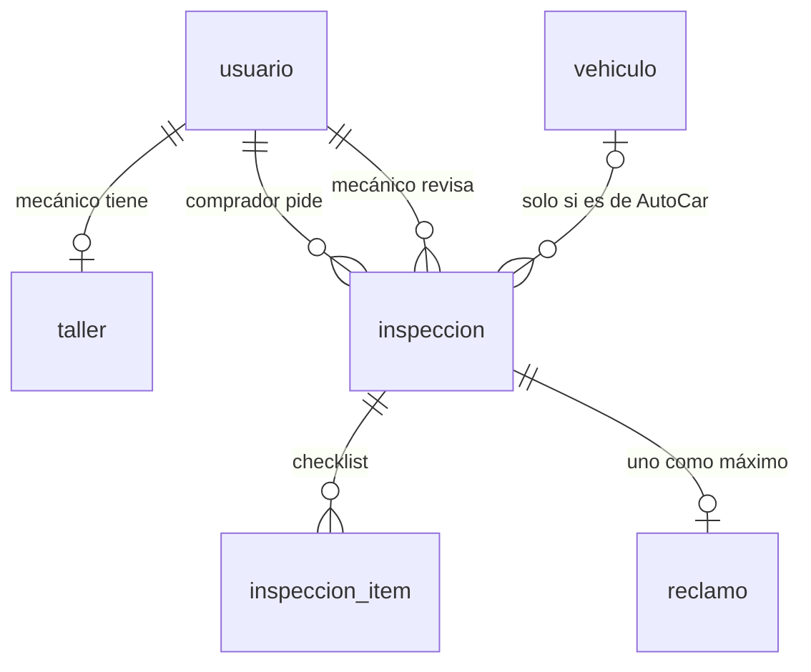
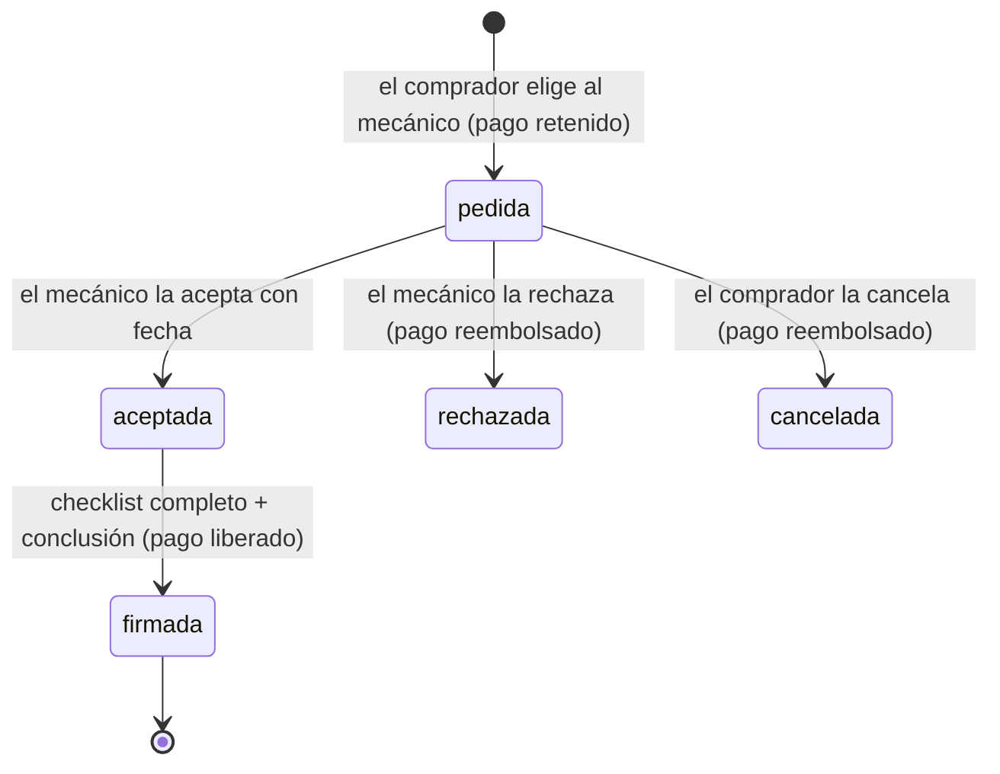

# Inspecciones: el mecánico que firma

Estado al 08/11/2026, en `dev` (vino de la rama `feat/inspecciones`). Ya están **la base de datos y las reglas de negocio**, con pruebas. Faltan los endpoints. El porqué del modelo y el plan completo están en `modelo-de-negocio/README.md` y `PLAN.md` del repo del front.

## 1. La idea

El comprador encuentra un auto en cualquier sitio (MercadoLibre, Kavak, Autocosmos o AutoCar), pega el link y **elige** un mecánico de la red por su ranking. El vendedor no puede elegirlo. El mecánico revisa el auto con un checklist y **firma el informe con su nombre**. Si se le pasó algo que se veía, el comprador reclama: si procede, se le devuelve la plata, se lo compensa y el mecánico baja en el ranking.

AutoCar se queda una parte de cada inspección. El pago, por ahora, es **simulado**: se guarda el desglose, pero no se cobra.

## 2. Los componentes

Las reglas son **funciones puras** en `src/Inspecciones/`: no tocan la base ni la red, así que se prueban solas (`tests/Unit/InspeccionesTest.php`). Los controladores, cuando estén, solo van a leer el pedido, llamar a estas reglas y guardar.

| Componente | Qué resuelve | Lo usa |
|---|---|---|
| **`Fuente`** | De qué sitio es el link: `mercadolibre`, `kavak`, `autocosmos`, `autocar` u `otro`. Mira solo la URL, no entra a la página. Si es de AutoCar (`vehiculo.html?id=N` en un host de `FRONT_URL`), devuelve también el id del vehículo | Pedir una inspección |
| **`Precio`** | El desglose: 23 % para AutoCar (redondeado a miles), un tercio de eso al fondo de garantía y el resto para el mecánico. También el tope de la compensación (3 veces el precio) | Pedir una inspección, resolver un reclamo |
| **`Checklist`** | Los 10 ítems que se revisan y sus resultados (`ok`, `observado`, `falla`). Valida lo que manda el mecánico: a medias para guardar, completo para firmar. Si un ítem no está "ok", pide la nota | Guardar el informe, firmar |
| **`Huella`** | El SHA-256 del informe (ítems, conclusión, resumen, mecánico, taller y fecha) en un orden fijo. Prueba que el informe no cambió después de firmarlo. **No es una firma digital con validez legal** | Firmar, mostrar el informe |
| **`Estados`** | Qué cambios de estado se permiten, cómo queda el pago con cada uno y el plazo de 15 días para reclamar | Aceptar, rechazar, cancelar, firmar, reclamar |
| **`Ranking`** | El puntaje público de cada mecánico y el orden de la lista. Sale solo de las inspecciones y los reclamos: nadie paga para subir | Lista de mecánicos |

### Cómo se relacionan



El ranking cierra el círculo: el mecánico que revisa mal recibe reclamos que proceden, baja en la lista y le piden menos inspecciones.

## 3. Las tablas

Están en `database/schema.sql` (y en `database/migracion-inspecciones.sql` para la base de Neon que ya existe).



| Tabla | Qué guarda |
|---|---|
| `taller` | El perfil del mecánico: nombre, dirección, localidad, teléfono y precio de la inspección. La clave es el `usuario_id` del mecánico. `demo = true` en los talleres de ejemplo |
| `inspeccion` | El pedido entero: quién pide, a qué mecánico, el link y la fuente, los datos del auto, el estado, los montos que se fijaron al pedir, el pago simulado y, al firmar, la conclusión, el nombre del mecánico y del taller, la fecha y la huella |
| `inspeccion_item` | Un renglón por ítem del checklist: código, resultado y nota |
| `reclamo` | El reclamo del comprador (uno por inspección): qué ítem, qué pasó, si procede, la compensación y quién lo resolvió |

**La base también controla** lo más importante, por si un endpoint se equivoca: los montos del mecánico y de AutoCar suman el precio, nadie se inspecciona a sí mismo y una inspección firmada tiene que tener conclusión, firmante, fecha y huella.

Se copian datos a la inspección a propósito: el precio y los montos (el taller puede cambiar su precio después) y el nombre del mecánico y del taller al firmar (el informe tiene que seguir diciendo lo mismo aunque el mecánico cambie su nombre).

## 4. El ciclo de una inspección



- Una inspección **firmada no cambia más**: cualquier intento tiene que dar 409.
- Después de la firma, el comprador tiene **15 días** para reclamar, una sola vez. Si el reclamo procede, el pago pasa a `reembolsado` y la compensación tiene un tope de 3 veces el precio.

## 5. El ranking

```
puntaje = 5 × (1 − 2 × reclamos que procedieron ÷ inspecciones firmadas), con mínimo 0
```

| Firmadas | Procedieron | Puntaje |
|---|---|---|
| 10 | 0 | 5,0 |
| 10 | 1 | 4,0 |
| 10 | 5 | 0,0 |
| 2 | 0 | "Nuevo en la red" (con menos de 3 no hay puntaje) |

Orden: primero el puntaje, después la cantidad de firmadas, y los nuevos al final.

## 6. Datos de demo

`database/demo-inspecciones.sql`, **solo para la base de dev**: 5 mecánicos de Mercedes y Luján con su taller, marcados como demo. La contraseña de todos es `mecanico-demo`. Las inspecciones firmadas de ejemplo se van a cargar con la API cuando esté la firma, para que la huella de cada informe sea la real.

## 7. Qué falta

Los endpoints, que van a usar todo lo de arriba (los números son los del `PLAN.md`):

| Tarea | Endpoint | Componentes que usa |
|---|---|---|
| B2 | `GET/PUT /api/mecanico/perfil` | — |
| B3 | `GET /api/mecanicos?localidad=` | `Ranking` |
| B4 | `POST /api/inspecciones` | `Fuente`, `Precio` |
| B5 | `GET /api/mis-inspecciones`, `GET /api/inspecciones/{id}`, `POST .../cancelar` | `Estados` |
| B6 | `GET/PATCH /api/mecanico/inspecciones...` | `Estados` |
| B7 | `PUT .../informe`, `POST .../firma` | `Checklist`, `Huella`, `Estados` |
| B8 | `POST /api/inspecciones/{id}/reclamo`, `GET/PATCH /api/admin/reclamos...` | `Estados`, `Precio`, `Ranking` |

Todavía no está decidido y no afecta a esta base:
- Qué datos del auto externo se completan solos con lo que juntó el scraper y cuáles carga el comprador.
- El precio de referencia ($ 130.000), el plazo para reclamar y el tope de la compensación. Son constantes (`Precio`, `Estados`): se cambian en un solo lugar.
