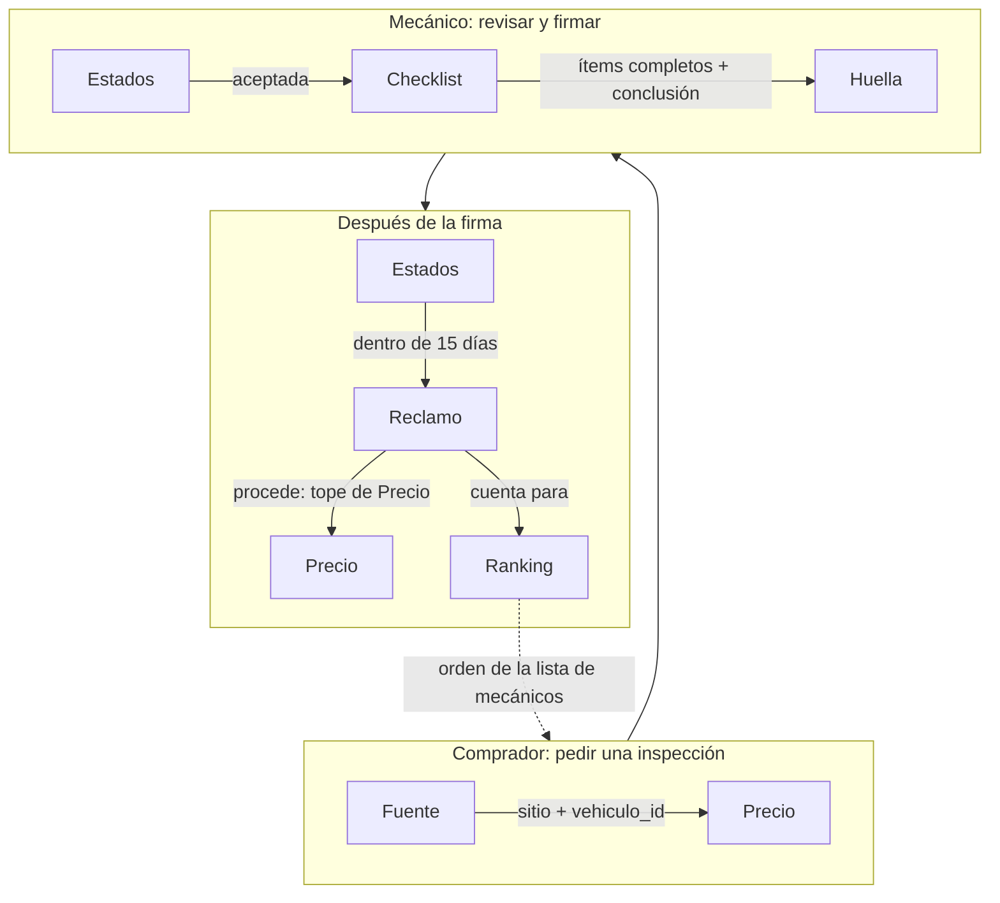
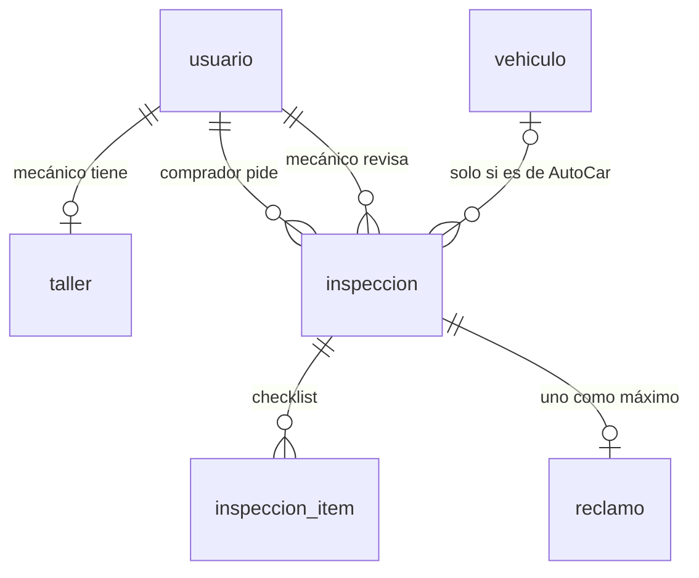
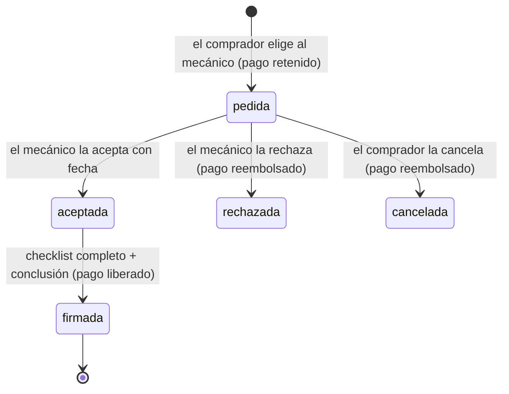

# Inspecciones: el mecánico que firma

Estado al 09/11/2026, en `dev` y `main`: la base, las reglas de negocio y todos los endpoints están hechos y con pruebas. Las reglas juntas están en el § 8. El porqué del modelo y el plan completo están en `modelo-de-negocio/README.md` y `PLAN.md` del repo del front.

## 1. La idea

El comprador encuentra un auto en cualquier sitio (MercadoLibre, Kavak, Autocosmos o AutoCar), pega el link y **elige** un mecánico de la red por su ranking. El vendedor no puede elegirlo. El mecánico revisa el auto con un checklist y **firma el informe con su nombre**. Si se le pasó algo que se veía, el comprador reclama: si procede, se le devuelve la plata, se lo compensa y el mecánico baja en el ranking.

AutoCar se queda una parte de cada inspección. El pago, por ahora, es **simulado**: se guarda el desglose, pero no se cobra.

## 2. Los componentes

Las reglas son **funciones puras** en `src/Inspecciones/`: no tocan la base ni la red, así que se prueban solas (`tests/Unit/InspeccionesTest.php`). Los controladores, cuando estén, solo van a leer el pedido, llamar a estas reglas y guardar.

| Componente | Qué resuelve | Lo usa |
|---|---|---|
| **`Fuente`** | De qué sitio es el link: `mercadolibre`, `kavak`, `autocosmos`, `autocar` u `otro`. Mira solo la URL, no entra a la página. Si es de AutoCar (`vehiculo.html?id=N` en un host de `FRONT_URL`), devuelve también el id del vehículo. El pedido rechaza los `otro` (422): el mecánico nunca abre un link de un sitio cualquiera | Pedir una inspección |
| **`Precio`** | El desglose: 23 % para AutoCar (redondeado a miles), un tercio de eso al fondo de garantía y el resto para el mecánico. También el tope de la compensación (3 veces el precio) | Pedir una inspección, resolver un reclamo |
| **`Checklist`** | Los 10 ítems que se revisan y sus resultados (`ok`, `observado`, `falla`). Valida lo que manda el mecánico: a medias para guardar, completo para firmar. Si un ítem no está "ok", pide la nota | Guardar el informe, firmar |
| **`Huella`** | El SHA-256 del informe (ítems, conclusión, resumen, mecánico, taller y fecha) en un orden fijo. Prueba que el informe no cambió después de firmarlo. **No es una firma digital con validez legal** | Firmar, mostrar el informe |
| **`Estados`** | Qué cambios de estado se permiten, cómo queda el pago con cada uno y el plazo de 15 días para reclamar | Aceptar, rechazar, cancelar, firmar, reclamar |
| **`Ranking`** | El puntaje público de cada mecánico y el orden de la lista. Sale solo de las inspecciones y los reclamos: nadie paga para subir | Lista de mecánicos |

### Cómo se relacionan



El ranking cierra el círculo: el mecánico que revisa mal recibe reclamos que proceden, baja en la lista y le piden menos inspecciones.

## 3. Las tablas

Están en `database/schema.sql` (y en `database/006-inspecciones.sql` para la base de Neon que ya existe).



| Tabla | Qué guarda |
|---|---|
| `taller` | El perfil del mecánico: nombre, dirección, localidad, teléfono y precio de la inspección. La clave es el `usuario_id` del mecánico. `demo = true` en los talleres de ejemplo |
| `inspeccion` | El pedido entero: quién pide, a qué mecánico, el link y la fuente, los datos del auto, el estado, los montos que se fijaron al pedir, el pago simulado y, al firmar, la conclusión, el nombre del mecánico y del taller, la fecha y la huella |
| `inspeccion_item` | Un renglón por ítem del checklist: código, resultado y nota |
| `reclamo` | El reclamo del comprador (uno por inspección): qué ítem, qué pasó, si procede, la compensación y quién lo resolvió |

**La base también controla** lo más importante, por si un endpoint se equivoca: los montos del mecánico y de AutoCar suman el precio, nadie se inspecciona a sí mismo y una inspección firmada tiene que tener conclusión, firmante, fecha y huella.

Se copian datos a la inspección a propósito: el precio y los montos (el taller puede cambiar su precio después) y el nombre del mecánico y del taller al firmar (el informe tiene que seguir diciendo lo mismo aunque el mecánico cambie su nombre).

## 4. El ciclo de una inspección



- Una inspección **firmada no cambia más**: cualquier intento tiene que dar 409.
- Después de la firma, el comprador tiene **15 días** para reclamar, una sola vez. Si el reclamo procede, el pago pasa a `reembolsado` y la compensación tiene un tope de 3 veces el precio.

## 5. El ranking

```
puntaje = 5 × (1 − 2 × reclamos que procedieron ÷ inspecciones firmadas), con mínimo 0
```

| Firmadas | Procedieron | Puntaje |
|---|---|---|
| 10 | 0 | 5,0 |
| 10 | 1 | 4,0 |
| 10 | 5 | 0,0 |
| 2 | 0 | "Nuevo en la red" (con menos de 3 no hay puntaje) |

Orden: primero el puntaje, después la cantidad de firmadas, y los nuevos al final.

## 6. Datos de demo

`database/007-demo-inspecciones-solo-dev.sql`, **solo para la base de dev**: 5 mecánicos de Mercedes y Luján con su taller, marcados como demo. La contraseña de todos es `mecanico-demo`. Las inspecciones firmadas de ejemplo (para que el ranking tenga números) se cargan con `php bin/demo-historial.php`, que firma con el mismo código que la API: así la huella de cada informe es la real.

## 7. Endpoints: hechos y pendientes

Los números son los del `PLAN.md`. Los controladores son `InspeccionController` (comprador y ranking público), `MecanicoController` y `AdminReclamoController`. El acceso a la base está en `Inspeccion`, `Taller` y `Reclamos`, y las reglas nuevas, también puras, en `Pedido` y `Reclamo`. Pruebas: `tests/Unit/Inspecciones*Test.php` y `tests/Integration/Inspecciones*Test.php`; `InspeccionesCompradorTest::testRecorridoDeLaDemo` recorre la demo del 30/11 entera por la API.

| Tarea | Endpoint | Componentes que usa | Estado |
|---|---|---|---|
| B2 | `GET/PUT /api/mecanico/perfil` | `Taller` | ✅ |
| B3 | `GET /api/mecanicos?localidad=` | `Ranking`, `Taller::red` | ✅ |
| B4 | `POST /api/inspecciones` | `Pedido`, `Fuente`, `Precio` | ✅ |
| B5 | `GET /api/mis-inspecciones`, `GET /api/inspecciones/{id}`, `POST .../cancelar` | `Estados` | ✅ |
| B6 | `GET/PATCH /api/mecanico/inspecciones...` | `Estados` (+ `validarTurno`, `validarMotivo`) | ✅ |
| B7 | `PUT .../informe`, `POST .../firma` | `Checklist`, `Huella`, `Estados` | ✅ |
| B8 | `POST /api/inspecciones/{id}/reclamo`, `GET/PATCH /api/admin/reclamos...` | `Reclamo`, `Estados`, `Precio` | ✅ |
| Adhesión | `POST /api/solicitudes-taller`, `GET/PATCH /api/admin/solicitudes-taller...` | `SolicitudTaller`, `Taller::validar` | ✅ |

**Quién no puede intervenir (409):** el mecánico no se pide una inspección a sí mismo (`mecanico_propio`), el vendedor no pide la de su propio auto de AutoCar (`vehiculo_propio`), no se elige al mecánico que publicó el auto (`mecanico_vendedor`) y nadie resuelve un reclamo sobre una inspección propia (`interes_propio`). Tampoco se pide dos veces el mismo link mientras hay una en curso (`duplicada`).

**Solo se eligen mecánicos de la red:** taller **aprobado** y activo, cuenta activa y un rol con `verificaciones.realizar`.

**Cómo se suma un mecánico ("Adherí tu taller").** El taller manda sus datos sin estar logueado (`POST /api/solicitudes-taller`) y eso le crea una **cuenta aparte**, con un email que no tenga otra cuenta (un email es una sola cuenta, y el login es el mismo para todos: el panel depende del rol). La cuenta nace con rol `mecanico` y la solicitud queda `pendiente`: no aparece en el ranking y el login responde 403 `taller_pendiente`. Así la cuenta con la que alguien compra o vende queda separada de la del taller que firma. Un admin lo revisa en la cola (`GET /api/admin/solicitudes-taller`) y lo aprueba o lo rechaza con un motivo. Al aprobarlo, su taller entra al ranking y ya puede ingresar; si lo rechaza, al querer ingresar ve el motivo (403 `taller_rechazado`) y puede volver a mandarla corregida con el mismo email y contraseña. Lo aprueba un admin (permiso `usuarios.editar`, porque le cambia el rol) y no el propio mecánico porque el valor de AutoCar es que **el que firma es confiable**: si cualquiera se pudiera anotar solo, el ranking no valdría nada. La solicitud es la misma fila de `taller`, con `estado`, `cuit`, `horarios`, `motivo_rechazo` y quién la resolvió (`009-solicitud-taller.sql`). El ranking público no muestra el teléfono: el contacto pasa por AutoCar.

**Cómo se evitan los problemas de concurrencia.** Aceptar y rechazar hacen `UPDATE ... WHERE estado = 'pedida'`: si el comprador cancela al mismo tiempo, solo uno de los dos cambia la fila y el otro recibe 409. Guardar el informe y firmar bloquean la fila (`SELECT ... FOR UPDATE`) dentro de una transacción.

**La huella se puede volver a calcular.** El momento de la firma entra en la huella en UTC y al segundo (`Inspeccion::momentoHuella`), así da lo mismo con lo que se guardó que con lo que se lee de la base. La prueba de integración lo verifica.

Todavía no está decidido y no afecta a esta base:
- Qué datos del auto externo se completan solos con lo que juntó el scraper y cuáles carga el comprador.
- El precio de referencia ($ 130.000), el plazo para reclamar y el tope de la compensación. Son constantes (`Precio`, `Estados`): se cambian en un solo lugar.

## 8. Reglas de negocio (resumen)

Todas están en el back (el front repite algunas para avisar antes, pero la que vale es la del back). Las constantes se cambian en un solo lugar.

**Cuenta del taller ("Adherí tu taller")**
- La cuenta del taller es **aparte** de la cuenta personal. Se crea con la solicitud, sin sesión (`POST /api/solicitudes-taller`).
- **Un email es una sola cuenta**: si el email ya tiene cuenta (aunque cambien mayúsculas), 422. El login es el mismo para todos; el panel depende del rol.
- Mientras la solicitud está **pendiente** o **rechazada**, la cuenta no puede ingresar (403 `taller_pendiente` / `taller_rechazado` con el motivo) y el taller no aparece en el ranking.
- La aprueba o rechaza **un admin** (`usuarios.editar`), nunca el propio taller. El rechazo lleva un motivo (5 a 300 caracteres).
- Rechazada, se vuelve a mandar con **el mismo email y la misma contraseña** (con otra, 422: así nadie pisa la solicitud de otro).
- En el front, el formulario se muestra solo **sin sesión**.

**Pedir una inspección**
- La pide y la paga **el comprador**. El vendedor no la elige ni la paga.
- Solo links de **MercadoLibre, Kavak, Autocosmos o AutoCar** (`Fuente`); otro sitio, 422. Se controla el dominio, **no** que el auto esté entre los que juntó el scraper.
- Solo mecánicos **de la red**: taller aprobado y activo, cuenta activa y con `verificaciones.realizar`.
- 409 si hay interés propio: el mecánico no se pide una a sí mismo (`mecanico_propio`), el vendedor no la pide para su auto (`vehiculo_propio`), no se elige al mecánico que publicó el auto (`mecanico_vendedor`), y no se pide dos veces el mismo link mientras hay una en curso (`duplicada`).

**Plata (`Precio`, el pago todavía es simulado)**
- Precio de referencia **$ 130.000** (cada taller pone el suyo). **77 %** para el mecánico y **23 %** para AutoCar (`COMISION`); de lo de AutoCar, **un tercio** va al fondo de garantía que paga los reclamos (`PARTE_FONDO`). Se redondea a $ 1.000.
- Los montos se guardan al pedirla: si el taller cambia el precio después, no afecta a las pedidas.
- Pago: `retenido` al pedir → `liberado` al firmar, o `reembolsado` si el mecánico la rechaza, el comprador la cancela o el reclamo procede.

**El informe**
- El mecánico acepta con un turno de **hasta 60 días** o rechaza con motivo.
- Checklist de **10 ítems** (`ok`, `observado` o `falla`); lo que no está `ok` exige nota. Conclusión: `recomendable`, `con_reparos` o `no_recomendable`.
- Para firmar hacen falta los 10 ítems y la conclusión. La firma guarda el nombre del mecánico y del taller, el momento y la **huella SHA-256**. Firmada, **no cambia más** (409).

**Reclamos y ranking**
- El comprador tiene **15 días** desde la firma para reclamar, **una sola vez** (`DIAS_RECLAMO`).
- Lo resuelve un moderador o admin (`reclamos.resolver`), nunca alguien con interés en esa inspección (`interes_propio`).
- Si procede: se devuelve el pago y la compensación llega hasta **3 veces** el precio (`TOPE_VECES`).
- Ranking: `5 × (1 − 2 × procedentes ÷ firmadas)`, mínimo 0; con **menos de 3** firmadas, "Nuevo en la red" (§ 5). Nadie paga para subir.
